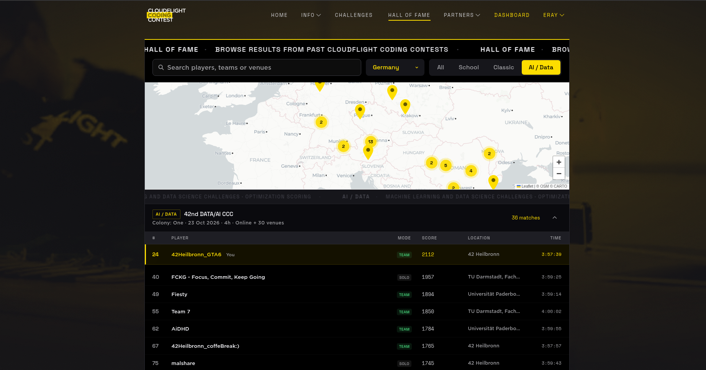
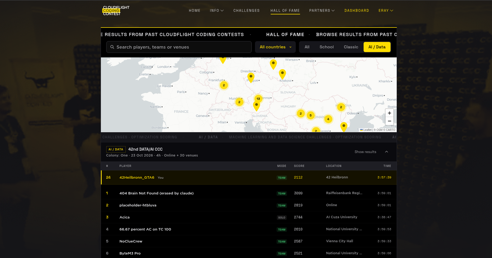
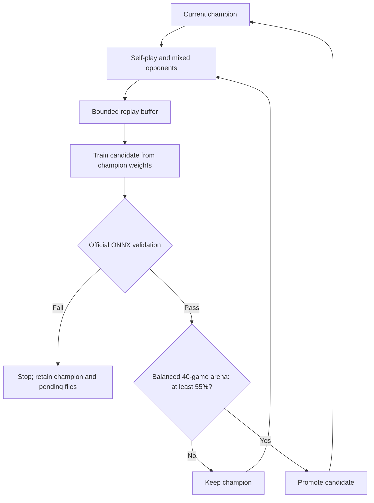
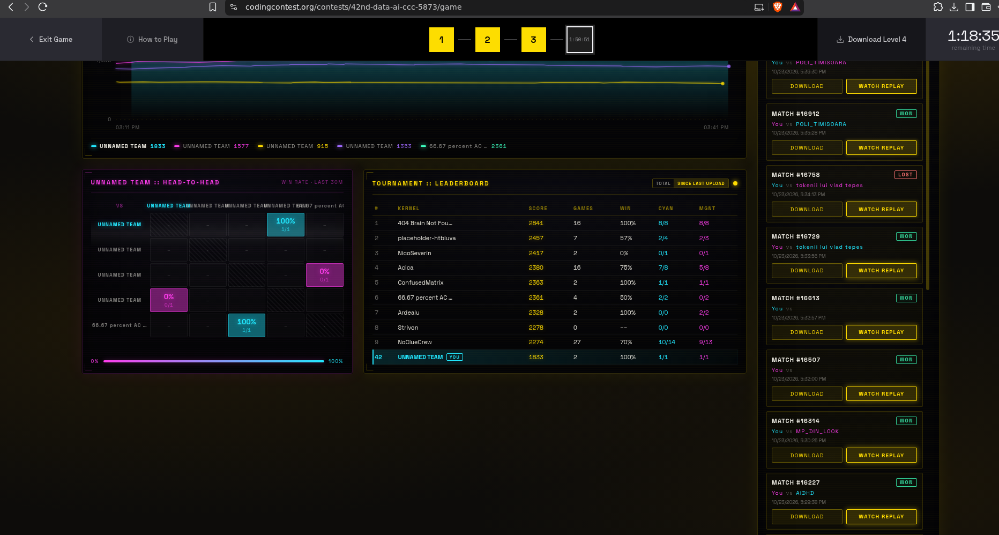

# 42nd DATA/AI CCC — Colony: One

**CPU-based policy/value learning for the 42nd Cloudflight Coding Contest — AI / Data track.**

This repository brings together our training code, the supplied game environment,
saved tournament replays, and the export fixes developed during the contest on
**23 October 2026** at **42 Heilbronn**.

| Result | Value | Evidence |
|---|---|---|
| Germany | **1st** | Germany-filtered Hall of Fame screenshot below |
| Overall placement | **24th** | Hall of Fame screenshot below |
| Final displayed score | **2112** | Hall of Fame screenshot below |
| Team | **42Heilbronn_GTA6** | Hall of Fame |



The Germany filter is selected above; the displayed rank numbers retain their
overall values. Our team appears ahead of the other listed German entries.

<details>
<summary>Overall ranking: 24th, score 2112</summary>



</details>

## What we built

We started by playing the game manually, trained a small model from a heuristic
MCTS teacher, and then moved to an iterative self-play pipeline. The model judges
positions and proposes promising actions; **the contest's supplied MCTS chooses
the moves**.

- A heuristic teacher and masked policy/value training for a first submission.
- Iterative self-play with previous champions, heuristic and greedy opponents.
- A rolling **50,000-position replay buffer**, sampled from **500-game cycles**.
- Continued training from the current champion's weights rather than reinitializing every cycle.
- Candidate evaluation with **100 simulations per action**, alternating colours.
- A local promotion gate: at least **55% wins in a 40-game arena**.
- ONNX export, the supplied validator, and recovery of a failed pending iteration.

The game engine, rules, board encoding, baseline agents, MCTS and original
submission checker were **provided by the contest**. They are retained with their
original license and are not presented as our own implementation. See
[THIRD_PARTY.md](THIRD_PARTY.md).

## Model and game

| Component | Contract |
|---|---|
| Board | 8 × 8; two consecutive actions per team turn |
| Input | `float32 (batch, 16, 8, 8)` |
| Policy | `float32 (batch, 4096)` raw logits; `from_square * 64 + to_square` |
| Value | `float32 (batch,)`, from the side-to-move perspective |
| Network | Two 16-channel convolutions, a 64-unit shared layer, policy and value heads |
| Parameters | 338,593 |
| Export | ONNX opset 17; dynamic batch; embedded weights; approximately 1.29 MiB |

The firewall gradually removes outer rings. Level 3 uses Kernel, Ping and Exploit;
Level 4 adds Trace, Daemon and Ice. The engine handles movement, bodyguards,
shooting, firewall timing and endgames. In particular, the value perspective does
**not** switch after every action: one team acts twice before handing over.

## Setup

Python **3.11–3.14**, 64-bit. The contest training used Python 3.11.14 on an
Intel Core i7-13700, with four game-generation workers and two training threads.
No GPU is required for this pipeline.

```bash
uv venv --python 3.11
source .venv/bin/activate
uv pip install -e .
uv pip install torch --index-url https://download.pytorch.org/whl/cpu
```

For storage-limited 42 Linux machines, use the external environment instructions
in [docs/42-linux.md](docs/42-linux.md). The original environment's dependency
snapshot is kept for reference in `docs/upstream/requirements-original.txt`;
it is not a complete lockfile for the PyTorch training environment.

## Train and evaluate

The repository defaults to the **Level 4** starting position. Select a scene
before training; do not switch it while another process is generating games.

```bash
python scripts/select_scene.py level4
python scripts/train_selfplay.py --games 1000 --workers 4 --out runs/selfplay
```

Continue toward a larger **total** budget:

```bash
python scripts/train_selfplay.py --resume --games 45000 --workers 4 --out runs/selfplay
```

The latest local champion is written to `runs/selfplay/best.onnx`. Every completed
cycle writes `state.json`, `history.jsonl`, candidate artifacts, and a validation
log. `--games` is the total target, not an additional game count. Training and
arena games are separate; the budget counts generated training games.

To start a new self-play run from a compatible earlier checkpoint, add
`--init /path/to/weights.pt`. To recover a candidate that was already trained but
failed export/validation, use `--resume --recover-pending` with the original
output directory. Use that recovery flag only when the pending candidate and its
replay are present; an ordinary interruption during generation uses just `--resume`.

Validate a model and compare it against another model:

```bash
python tools/validate_submission.py runs/selfplay/best.onnx
python play/model_vs_model.py \
  --model-a runs/selfplay/best.onnx \
  --model-b play/random.onnx \
  --games 100 --simulations 100
```

`play/random.onnx` is a supplied evaluator running **inside MCTS**, not a uniformly
random move picker. For a terminal game against genuinely random legal moves:

```bash
python scripts/manual_play.py
```

The earlier teacher-based trainer is retained as `scripts/train_bootstrap.py`.
For a Level 3 run, select `level3` first; for a Level 4 run use its `--level4` flag.

## How self-play improves a candidate



Before a learned champion is available, the first batch uses a handcrafted teacher.
Subsequent batches allocate 70% of game IDs to current-model self-play, 10% to a
recent champion when available, 10% to the teacher and 10% to the greedy bot.
The training policy target is the MCTS visit distribution over **legal** moves;
the value target is the final game outcome from the recorded player's perspective.
Whole games are held out for validation using fixed membership across iterations.

## Results and lessons

Early smoke tests produced 29/40 wins against the greedy bot, followed by 36/40
against the preceding local model. These are development checks, **not estimates
of the final model's performance against the tournament field**. A locally promoted
model initially performed poorly live, and we reverted the submission.

Two export issues were fixed during the contest:

1. **`Constant` rejected by the operator allow-list.** Constant tensors are moved
   to graph initializers without changing their values or tensor names.
2. **Strict value bounds.** An explicit clamp to `[-0.999999, 0.999999]` leaves a
   small margin around the validator's exact float32 limits. Floating-point
   overshoot was a likely explanation for the original rejection, not a measured
   diagnosis from the saved log alone.

The final candidate's weights were recoverable after a validation failure, avoiding
repeating its completed training batch. Candidate improvements are checked locally;
a small arena still cannot guarantee improvement against a diverse tournament field.

### Saved tournament games

Two exports contain **60 unique match records**: **53 complete protocols** and
**7 metadata-only records**. All 53 protocols replay successfully through the
bundled engine. They contain **37 wins and 16 losses** from our recorded side;
the other seven results are left unknown. These exports span multiple submissions
and are not a complete tournament history.

The source `score` matches **CYAN's result** in all 53 records with winner text.
Our analysis therefore uses the protocol winner and `you` field instead of
assuming `score` is always our outcome.

```bash
python scripts/analyze_matches.py
python scripts/replay_matches.py
python scripts/replay_matches.py --match-id 23401 --render
python -m unittest discover -s tests -v
```

See [results/match-summary.json](results/match-summary.json),
[results/matches.csv](results/matches.csv), and
[results/replay-validation.json](results/replay-validation.json).

<details>
<summary>Earlier live tournament dashboard</summary>



This is an in-contest snapshot, not the final result. Its table was set to
**Since last upload**, so those game counts must not be read as lifetime totals.

</details>

## Repository layout

| Location | Contents |
|---|---|
| `colony_one/` | Supplied engine and search; Level 4 default scene |
| `scripts/` | Our trainers, manual play, artifact collection, replay and analysis tools |
| `tools/`, `play/` | Supplied validator, model-vs-model runner and sample model |
| `scenes/` | Separate Level 3 and Level 4 starting positions |
| `data/tournament/raw/` | The two original tournament JSON exports |
| `results/` | Reproducible match summaries and replay verification |
| `models/` | Selected baselines, latest local champion, and the explicitly selected final submission |
| `docs/` | Rules, model contract, screenshots, provenance and curation notes |
| `archive/incomplete/` | An incomplete auxiliary generator, excluded from the active pipeline |

### Final submission and subsequent training

The final model uploaded to the tournament was **`best_8.onnx`**. The collector
publishes this explicitly selected file as **`models/submission.onnx`**.
Training continued after that upload, reaching **55,000 training games** and the
snapshot **`best_10.onnx`**. That later snapshot was not the final tournament upload.

The original source archive did not include the separately stored model binaries
or training logs. Import the selected real artifacts before publishing:

```bash
python3 scripts/collect_training_artifacts.py \
  --source "/goinfre/$USER/colony-training" \
  --winner "/goinfre/$USER/colony-training/selfplay/best_8.onnx" \
  --include-weights \
  --include-snapshots \
  --include-shared-models
```

See [docs/TRAINING_ARTIFACTS.md](docs/TRAINING_ARTIFACTS.md) for the full selection
policy. `models/latest-selfplay.onnx` records the latest local champion separately
from the submitted model. Corresponding checkpoint weights are included only when
the saved candidate ONNX has a matching SHA-256 hash.

### Model evolution and team contributions

Numbered snapshots are archived in `models/evolution/`, preserving their original
`best_N.onnx` filenames. `results/training/model-evolution.csv` records their hashes,
matching iteration candidates, and whether they match the submitted model.
The snapshot numbers are saved version labels; they are not assumed to correspond
to exact training-game counts. `best_8.onnx` was the final upload; training later
reached 55,000 games and the `best_10.onnx` snapshot.

**Tobias Kern was a teammate.** His contributed models are kept in
`models/team/tkern/`. Models shared by other peers are kept under
`models/community/<contributor>/`. Their manifests retain contributor attribution;
these files are not presented as products of our self-play run. Keep contributor
permission and any supplied model-license terms with shared binaries when publishing.

## Attribution and license

Team: **42Heilbronn_GTA6**, 42 Heilbronn, including **Eray Çakıray and Tobias**.
This was an AI-assisted contest workflow
using ChatGPT/Codex for implementation and debugging.

The supplied environment is copyright **Paul Puntschart (2026)**. Its custom
license is retained verbatim in [LICENSE](LICENSE), including its non-commercial
and event-use conditions. This repository does not relicense that material as MIT
or Apache. See [THIRD_PARTY.md](THIRD_PARTY.md) and
[docs/CURATION.md](docs/CURATION.md) for source boundaries and packaging changes.

Contest website: [Cloudflight Coding Contest](https://codingcontest.org/).
